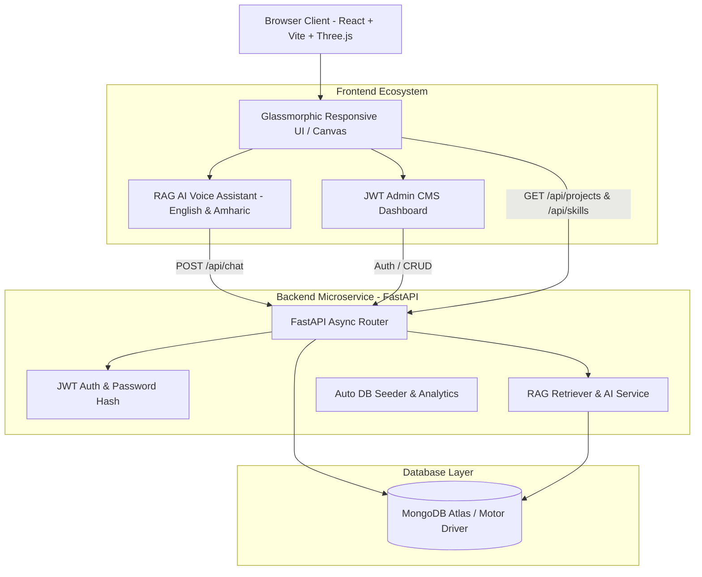

# KibretAI Portfolio Platform 🧠⚡

A world-class, production-ready AI Engineer & Machine Learning Researcher Portfolio Platform built for **Kibret Mulugeta Alemu**.

Inspired by elite Silicon Valley design aesthetics (OpenAI, Google DeepMind, NVIDIA AI), featuring dark futuristic glassmorphism (`#050816`), an interactive 3D WebGL particle neural brain canvas, RAG-powered AI portfolio assistant with **English & Amharic voice interaction**, and a full JWT-protected admin management console.

---

## 📐 Architecture Diagram



---

## 🌟 Key Features

1. **Futuristic Silicon Valley Aesthetics**:
   - Palette: Dark primary background `#050816`, Cyber Blue (`#00f0ff`), Neural Purple (`#8b5cf6`), AI Green (`#00ff9d`).
   - Interactive Three.js 3D Neural Brain sphere with mouse hover reactivity.
   - Interactive canvas particle mesh background.

2. **Full Portfolio Sections**:
   - **Hero**: Animated typography, quick stats (99.72% U-Net Accuracy), CV download, profile card.
   - **About & Academic**: MSc in AI & Data Engineering (Bahir Dar University), thesis focus on *"Reward-Driven Neural Plasticity Inspired Optimization for Enhancing U-Net Based Medical Image Segmentation"*.
   - **Interactive Skills Matrix**: Grouped proficiencies with animated progress bars (PyTorch, TensorFlow, MONAI, FastAPI, Docker, MongoDB).
   - **Dynamic Projects Showcase**: Loaded from MongoDB with detailed modal architectural breakdown views.
   - **Research Showcase**: Dedicated focus on Kibret's MSc thesis research with measured Dice metrics and experimental results.
   - **Career Timeline**: Animated roadmap highlighting key academic and engineering achievements.
   - **Technical Writings Blog**: Searchable articles with Markdown formatting.
   - **Contact Form**: Message persistence into MongoDB with toast feedback.

3. **RAG AI Portfolio Assistant**:
   - Endpoint: `/api/chat`.
   - Answers visitor queries about Kibret's research, skills, and projects.
   - **Multilingual Support**: English & Amharic (`am-ET`).
   - **Voice Interaction**: Integrated Web Speech API Speech-to-Text (STT) microphone and Text-to-Speech (TTS) voice audio playback.

4. **Protected Admin Management Console (`/admin`)**:
   - Secured via JWT Bearer authentication.
   - Visitor analytics overview metrics.
   - Full CRUD control for Projects, Skills, Blogs, and Messages.

---

## 🛠️ Tech Stack

- **Frontend**: React, Vite, JavaScript, Tailwind CSS, Framer Motion, Three.js, GSAP, Lucide Icons, Canvas Confetti.
- **Backend**: Python FastAPI, Async Motor MongoDB driver, PyJWT, Passlib (Bcrypt), Pydantic v2, Uvicorn.
- **Database**: MongoDB Atlas (with in-memory mock fallback).
- **Deployment & Containers**: Docker (multi-stage), Vercel (`vercel.json`), Render (`render.yaml`).

---

## 🚀 Quick Start & Local Setup

### Prerequisites
- Node.js (v18+)
- Python (v3.10+)

### 1. Run Backend Server
```bash
cd backend
python -m venv venv
# On Windows:
venv\Scripts\activate
# On Linux/macOS:
source venv/bin/activate

pip install -r requirements.txt
uvicorn app.main:app --reload --port 8000
```
Backend API will be live at `http://localhost:8000` (Interactive API docs at `http://localhost:8000/docs`).

### 2. Run Frontend Development Server
```bash
cd frontend
npm install
npm run dev
```
Frontend web application will be live at `http://localhost:3000`.

---

## 🔐 Admin Credentials (Default)

- **Email**: `admin@kibret.ai`
- **Password**: `AdminKibret2025!`

---

## 📦 Deployment Instructions

### Frontend (Vercel)
1. Import `frontend/` directory into Vercel.
2. Set Build Command to `npm run build` and Output Directory to `dist`.
3. Set environment variable `VITE_API_URL` to your production backend URL.

### Backend (Render)
1. Deploy `backend/` directory as a Web Service on Render using Python runtime.
2. Environment variables: `MONGODB_URL`, `JWT_SECRET`, `GEMINI_API_KEY` (optional).
3. Start Command: `uvicorn app.main:app --host 0.0.0.0 --port $PORT`.

---

## 📄 License
Designed and engineered for **Kibret Mulugeta Alemu**. All rights reserved.
